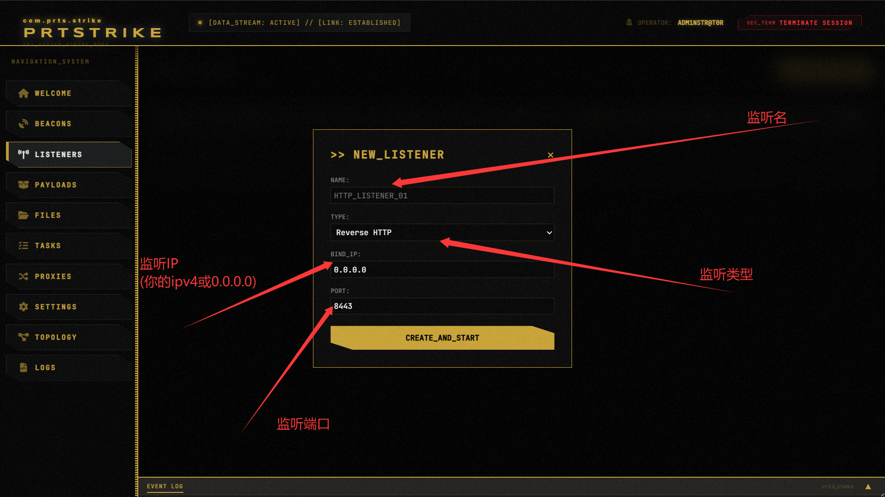
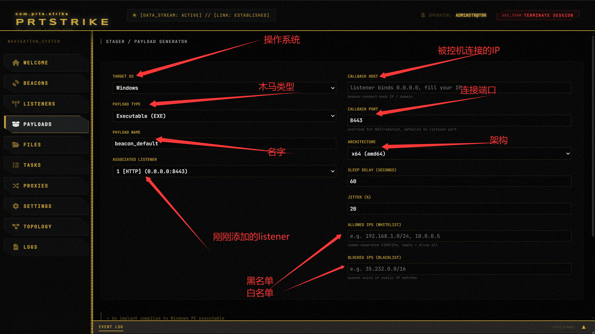
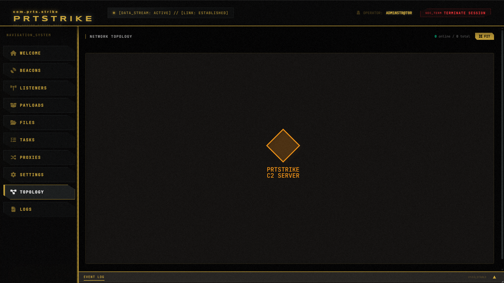

# PRTSTRIKE — Light · Small · Quick


> **Note：请务必完整看完此 README 再使用本工具。**


---

## 0x01 Introduction

PRTSTRIKE 是一个轻便、小巧、快捷的轻量化 C&C 框架，由 **Go** 编写，最快可 **1 分钟**部署完成。

---

## 0x02 Quick Start

### 方式一：源码运行

```bash
git clone https://github.com/Team-intN18-SoybeanSeclab/prtstrike.git
cd prtstrike
go run .
```

### 方式二：Docker 部署

```bash
docker build -t prtstrike .
docker run -d -p 8083:8083 --name prts prtstrike
```

### 首次登录

**本版本没有内置默认密码。** 首次启动时：

- 若设置了环境变量 `PRTS_ADMIN_USER` / `PRTS_ADMIN_PASS`，使用其创建管理员账户；
- 否则生成随机密码，打印到控制台，并写入工作目录下的 `admin_credentials.txt`（权限 0600）。

**登录后请立即在 Settings 中修改密码。**

---

## 0x03 Features

1. **对等集群** — 多台 C2 组成对等多主集群（见 0x04）
2. **植入体持久化** — Windows（注册表 Run / 启动文件夹 / 计划任务）、Linux（cron / systemd 用户服务 / profile）、macOS（LaunchAgent），生成载荷时可选择；支持**一键卸载**（控制台 `uninstall` 或 `POST /api/clients/:id/uninstall`：清理持久化痕迹 + 删除载荷本体 + 退出）
3. **拓扑图** — 可视化网络拓扑
4. **屏幕截图** — 远程截屏（BMP 编码，体积更小）
5. **文件浏览器** — 本地 + 远程文件管理（分块流式上传 / Range 下载）
6. **Payload 生成** — 多种格式一键生成
   - EXE / ELF（Go 编译）
   - PowerShell / Python / Bash 脚本
   - BIN / RAW（原始 PE 字节）
   - Shellcode 源码（C / C# / Go RunPE Loader）
7. **回连过滤**
   - 黑/白名单 IP / CIDR 过滤
   - 沙箱检测（开机时间、硬件规格、分析工具进程）
   - 植入体本地接口地址匹配（不再外呼公网 IP 回显服务）

---

## 0x04 集群部署

多台 C2 可组成 **对等多主集群**：任意节点可查看全部信标、下达任务、启停任意节点上的监听器；信标始终回连其归属节点的监听器，任务跨节点自动转发，结果自动回传发起节点。

**步骤：**

1. 节点 A 控制台进入 **CLUSTER** → `GENERATE_INVITE`，得到一次性邀请码（15 分钟有效）；
2. 节点 B 控制台进入 **CLUSTER** → `JOIN_CLUSTER`，填入 A 的 URL + 邀请码；
3. 两节点自动完成 HMAC 密钥交换、状态快照同步；后续新节点加入会自动组网。

节点间通信使用每对节点独立的 HMAC 令牌签名；内部接口挂载在 `/cluster/*`。

---

## 0x05 注意事项

### 环境变量

| 变量 | 说明 | 默认 |
|------|------|------|
| `PRTS_ADDR` | 监听地址 | `:8083` |
| `PRTS_DB_PATH` | SQLite 路径 | `prts_c2.db` |
| `PRTS_FM_ROOT` | 本地文件管理器根目录 | `./files` |
| `PRTS_SECRET` | Session 密钥（≥32 字节） | 每次启动随机生成 |
| `PRTS_ADMIN_USER` | 初始管理员用户名 | `prtadmin` |
| `PRTS_ADMIN_PASS` | 初始管理员密码 | 随机生成并写入 `admin_credentials.txt` |

### Tests

```bash
go test ./...
```

### 轻量构建

生产环境可关闭 Gin 的 MsgPack 支持以减小服务端体积：

```bash
CGO_ENABLED=0 go build -trimpath -buildvcs=false -tags=nomsgpack -ldflags="-s -w -buildid=" -o prtstrike .
```

- 首次使用时，建议配置 Go 代理：
  ```bash
  go env -w GO111MODULE=on
  go env -w GOPROXY=https://goproxy.cn,direct
  ```

- 运行环境仅需 [Golang](https://golang.google.cn/)（Docker 方式无需本地安装）

- 默认端口为 **8083**，可通过 `PRTS_ADDR` 修改

---

## 0x06 How to Use

1. 启动：`go run .`，从控制台或 `admin_credentials.txt` 获取初始凭据
2. 访问：`http://[IP]:8083`
3. 登录：使用初始账户登录，**立即修改密码**
4. 添加监听：点击 **LISTENERS** → 新建
   
5. 生成木马：点击 **PAYLOADS** → 选择类型与持久化方式生成
   
6. 内网穿透：监听填内网 IP:Port，Payload 填穿透公网 IP:Port
7. 查看拓扑：在 **TOPOLOGY** 页面查看
   
8. 集群：在 **CLUSTER** 页面生成/使用邀请码组网

---

## 0x07 Disclaimer

1. 您的下载、安装、使用或修改本工具及相关代码，意味着您对本工具的信任。
2. 本工具在使用过程中可能对您或他人造成损失或伤害，若发生此类情况，我们不承担任何责任。
3. 如果您因使用本工具而从事任何非法行为，您将自行承担一切后果，并且我们不承担任何法律责任或连带责任。
4. 请在使用前，仔细阅读并充分理解所有条款，特别是关于责任免除或限制的条款，并自行决定是否接受。
5. 除非您已经完全理解并接受所有条款，否则您无法下载、安装、使用本工具。
6. 您的任何下载、安装、使用行为，均视为您已完全阅读并同意本协议条款。
